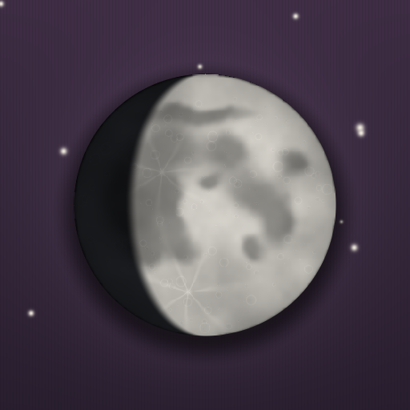
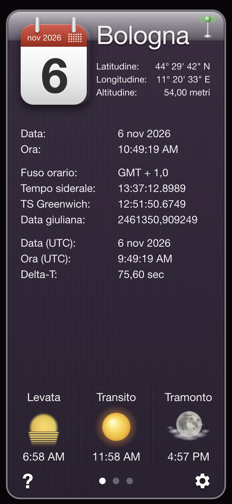
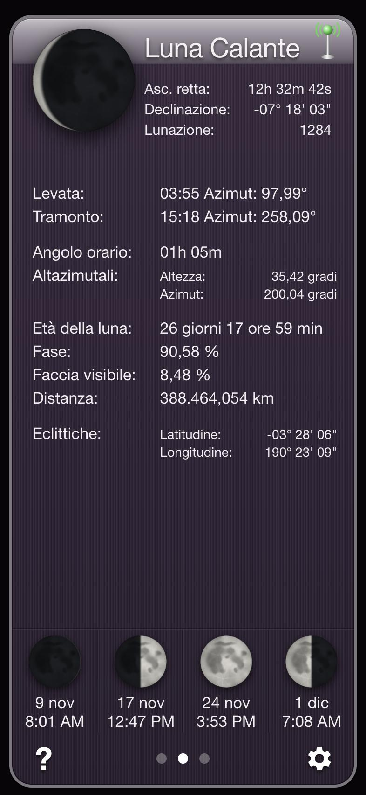
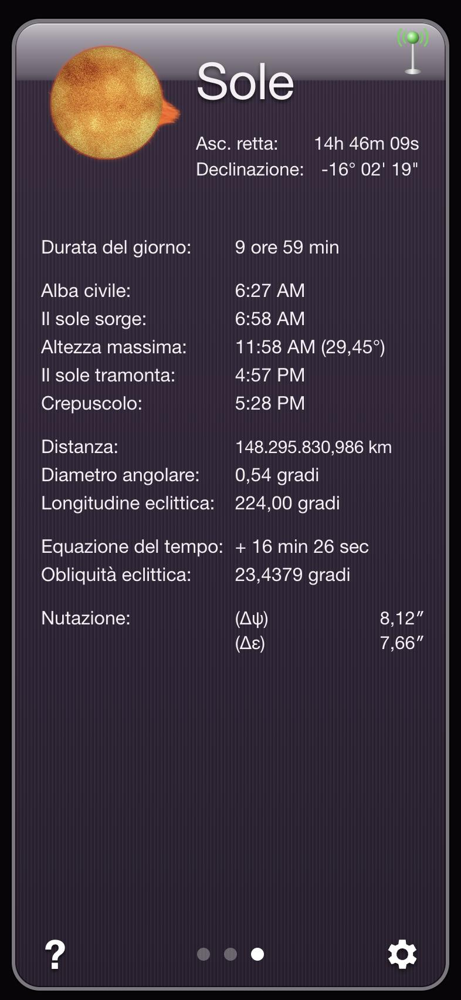

# Effemeridi

Effemeridi astronomiche per iPhone (e qualsiasi browser): tempo siderale, data giuliana, posizione e fasi della Luna, percorso del Sole, calcolati in tempo reale per il luogo scelto.

**Apri l'app:** https://surfab.github.io/effemeridi/

Su iPhone: apri il link in Safari → Condividi → *Aggiungi alla schermata Home*.

<table>
  <tr>
    <td align="center"> <b>Tempo</b></td>
    <td align="center"> <b>Luna</b></td>
    <td align="center"> <b>Sole</b></td>
  </tr>
</table>

## Schermate

- **Tempo** — data e ora locali e UTC, fuso orario, tempo siderale locale e di Greenwich, data giuliana, Delta-T, levata/transito/tramonto del Sole.
- **Luna** — fase, ascensione retta e declinazione, lunazione, levata e tramonto con azimut, angolo orario, altezza e azimut, età, illuminazione, distanza, coordinate eclittiche, prossime quattro fasi.
- **Sole** — durata del giorno, alba e crepuscolo civili, altezza massima, distanza, diametro angolare, longitudine eclittica, equazione del tempo, obliquità, nutazione.

Si passa da una schermata all'altra scorrendo con il dito. Gli indirizzi `#tempo`, `#luna` e `#sole` aprono direttamente la schermata corrispondente.

Impostazioni: emisfero, unità metriche/imperiali, formato 12/24 ore, tempo reale o data e ora a scelta, posizione (GPS, città o coordinate), fuso e ora legale, lingua italiana/inglese.

## Calcoli

Algoritmi di Jean Meeus, *Astronomical Algorithms* (2ª ed.): Sole (cap. 25), Luna (cap. 47), fasi lunari (cap. 49), nutazione (cap. 22), coordinate topocentriche (cap. 40), Delta-T secondo i polinomi di Espenak e Meeus. Precisione: circa un minuto per levate e tramonti, pochi secondi d'arco per le posizioni.

Un solo file `index.html`, senza dipendenze esterne. Sole e Luna sono disegnati dal codice.

## Nome del luogo con il GPS

Con il GPS attivo l'app mostra il nome del comune italiano in cui ti trovi, scegliendo tra tutti i 7.904 comuni (tiene conto anche della popolazione, perché una città grande copre più territorio di un paese). Fuori dall'Italia usa un piccolo elenco di città del mondo. Il calcolo avviene sul telefono: la posizione non viene inviata a nessun servizio.

Dati dei comuni: [geolocalizzazione-comuni-italiani](https://github.com/ggbaro/geolocalizzazione-comuni-italiani) di Christian Di Maio (licenza MIT). 61 coordinate risultate errate (comuni collocati all'estero o lontani dalla propria provincia) sono state corrette con dati © [OpenStreetMap](https://www.openstreetmap.org/copyright) contributors (ODbL).

## Origine

Ricostruita come omaggio a un'app per iPhone usata per anni, *iEphemeris Pro* di Marco Piccone (2008–2018), non più disponibile. Codice, grafica e testi sono nuovi.

## Licenza

[MIT](LICENSE). Il file della licenza riporta anche le note sui dati di terze parti (coordinate dei comuni e correzioni da OpenStreetMap).
